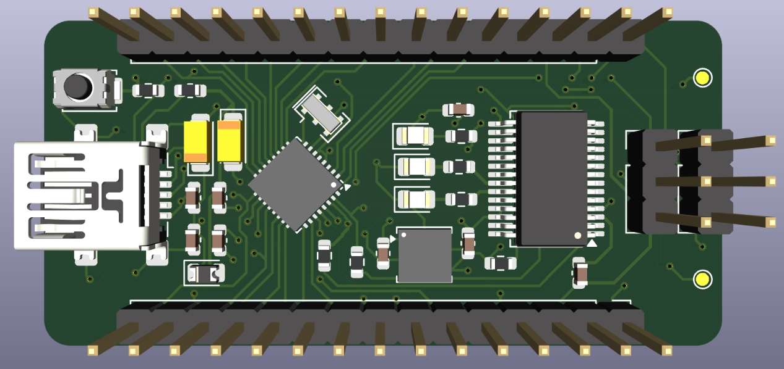
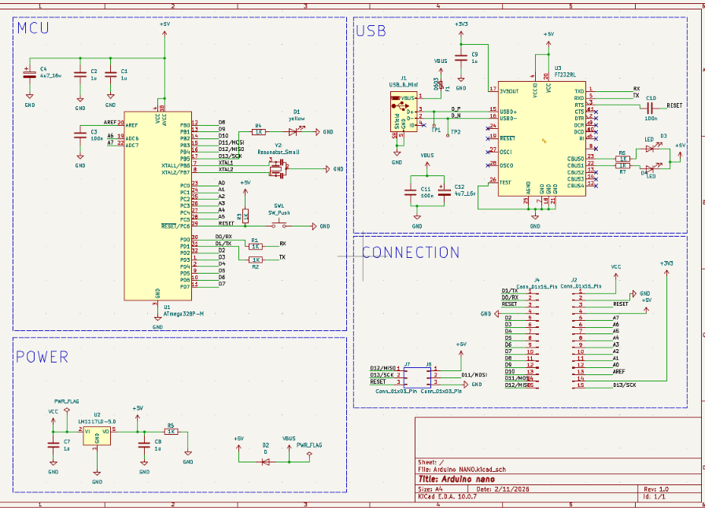
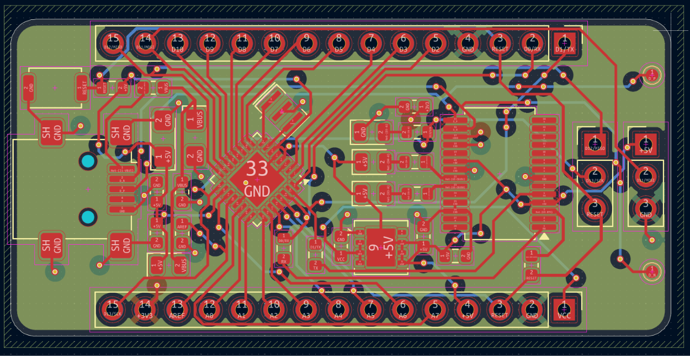

# Arduino Nano (ATmega328P) Board

A custom Arduino Nano-compatible board designed in KiCad. It uses an ATmega328P in a QFN-32 package, an FT232RL for USB-to-serial, and a mini-USB connector. The 5 V rail comes from USB or from the VCC pin through an LM1117-5.0 regulator. All I/O pins are brought out on two 15-pin headers. It is built on a 4-layer PCB.



## What is Arduino Nano?

The Arduino Nano is a small, breadboard-friendly microcontroller board built around the ATmega328P. It is programmed through the Arduino IDE over USB and is widely used for prototypes, robotics, sensor projects and learning embedded systems.

| Feature | ATmega328P |
|---|---|
| Architecture | 8-bit AVR |
| Logic level | 5 V |
| Flash | 32 KB |
| SRAM | 2 KB |
| EEPROM | 1 KB |
| Digital I/O | 14 (D0 to D13) |
| Analog inputs | 8 (A0 to A7), 10-bit ADC |
| Interfaces | UART, SPI, I²C, PWM |

## Features

- ATmega328P-MU microcontroller (QFN-32)
- FT232RL USB-to-UART bridge with auto-reset (RTS through a 100 nF capacitor to RESET)
- Mini-USB (type B) connector
- LM1117-5.0 regulator for the 5 V rail
- Diode (D2) between USB VBUS and the 5 V rail
- 3.3 V output from the FT232RL, available on header pin +3V3
- Resonator (Y2) as the clock source
- RESET button
- User LED (yellow) on D13, TX/RX indicator LEDs on the FT232RL CBUS pins
- Two 3-pin ICSP-style headers (J6, J7) for SPI programming
- Two 1×15 pin headers (J4, J2) for I/O
- Test points TP1, TP2 on the USB data lines
- 4-layer PCB

## PCB Stackup

| Layer | Name | Use |
|:-:|---|---|
| 1 | F.Cu | Signal and components |
| 2 | In1.Cu | GND plane |
| 3 | In2.Cu | Power plane (+3.3 V) |
| 4 | B.Cu | Signal |

## Pinout

### J4 (top header)

| Pin | Name | Pin | Name |
|:-:|:-:|:-:|:-:|
| 1 | D1/TX | 9 | D6 |
| 2 | D0/RX | 10 | D7 |
| 3 | RESET | 11 | D8 |
| 4 | GND | 12 | D9 |
| 5 | D2 | 13 | D10 |
| 6 | D3 | 14 | D11/MOSI |
| 7 | D4 | 15 | D12/MISO |
| 8 | D5 | | |

### J2 (bottom header)

| Pin | Name | Pin | Name |
|:-:|:-:|:-:|:-:|
| 1 | VCC | 9 | A3 |
| 2 | GND | 10 | A2 |
| 3 | RESET | 11 | A1 |
| 4 | +5V | 12 | A0 |
| 5 | A7 | 13 | AREF |
| 6 | A6 | 14 | +3V3 |
| 7 | A5 | 15 | D13/SCK |
| 8 | A4 | | |

### ICSP headers (J6, J7)

| J7 Pin | Name | J6 Pin | Name |
|:-:|:-:|:-:|:-:|
| 1 | D12/MISO | 1 | +5V |
| 2 | D13/SCK | 2 | D11/MOSI |
| 3 | RESET | 3 | GND |

> Logic is 5 V. Do not apply more than 5 V to any I/O pin.

## Schematic



| Block | Purpose |
|---|---|
| MCU | ATmega328P (U1), resonator Y2, RESET button SW1, D13 LED D1, decoupling C1 to C4 |
| USB | Mini-USB J1, FT232RL (U3), TX/RX LEDs, C9 to C12, test points TP1/TP2 |
| Power | LM1117-5.0 (U2), C7, C8, D2 |
| Connection | J4, J2 headers and J6, J7 ICSP headers |

## PCB

### Layout



## Bill of Materials

| Reference | Value | Qty |
|---|---|:-:|
| U1 | ATmega328P-MU | 1 |
| U2 | LM1117LD-5.0 | 1 |
| U3 | FT232RL | 1 |
| Y2 | Resonator | 1 |
| D1 | LED (yellow) | 1 |
| D3 | LED (TX/RX indicators) | 2 |
| D2 | Diode | 1 |
| F1 | Fuse | 1 |
| C3, C10, C11 | 100 nF | 3 |
| C1, C2, C7, C8, C9 | 1 µF | 5 |
| C4, C12 | 4.7 µF, 16 V | 2 |
| R1 to R7 | 1 kΩ | 7 |
| SW1 | Tactile switch | 1 |
| J1 | Mini-USB B connector | 1 |
| J4, J2 | 1×15 pin header, 2.54 mm | 2 |
| J6, J7 | 1×3 pin header, 2.54 mm | 2 |

## Usage

1. Install the FTDI driver if the COM port does not appear.
2. Connect the board to your PC with a mini-USB cable.
3. In Arduino IDE, select **Arduino Nano** and the **ATmega328P** processor.
4. Select the COM port and upload.

A new ATmega328P has no bootloader. Burn it once through the ICSP headers (J6, J7) with an ISP programmer, using **Tools > Burn Bootloader**.

Test sketch (blinks the yellow LED on D13):

```cpp
void setup() {
  pinMode(13, OUTPUT);
}

void loop() {
  digitalWrite(13, HIGH);
  delay(500);
  digitalWrite(13, LOW);
  delay(500);
}
```

## Files

| File | Description |
|---|---|
| `ARDUINO_schematic.png` | Schematic image |
| `ARDUINO_layout.png` | PCB layout image |
| `ARDUINO_3D.png` | 3D render |
| `ATMEGA328P-MU.STEP` | 3D model of the ATmega328P |
| `LM1117LD-5_0_NOPB.STEP` | 3D model of the LM1117-5.0 |

Open the KiCad project in KiCad 10 or newer.

## Author

Kaushik, B.E. Electronics and Communication Engineering, Chennai Institute of Technology

## License

MIT License
