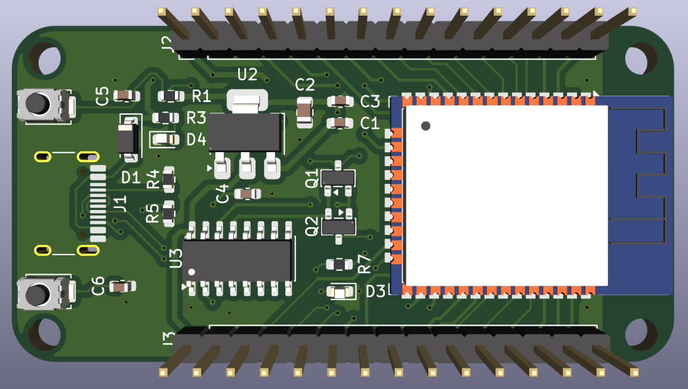
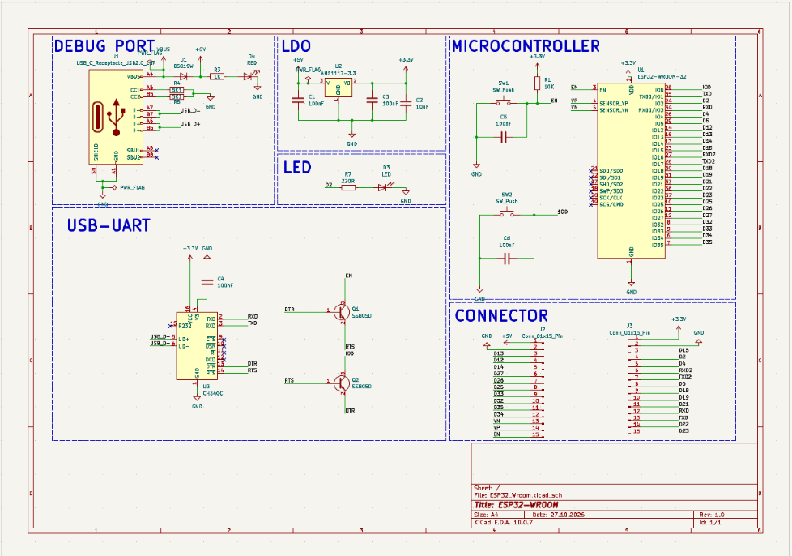
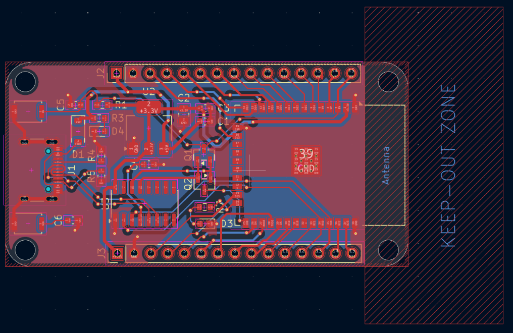

# ESP32-WROOM-32 Development Board

A custom ESP32 development board designed in KiCad. It is powered and programmed over USB-C, regulates 5 V to 3.3 V on board, and brings out the GPIO pins on two 15-pin headers.



## What is ESP32?

The ESP32 is a low-cost, low-power System-on-Chip from Espressif Systems. It combines a dual-core microcontroller with Wi-Fi and Bluetooth, which makes it popular for IoT, wearables, sensors and automation. The ESP32-WROOM-32 is a ready-made module with the chip, flash memory, crystal and PCB antenna in one package.

| Feature | ESP32 |
|---|---|
| CPU | Dual-core Xtensa LX6, up to 240 MHz |
| Wireless | Wi-Fi 802.11 b/g/n, Bluetooth v4.2 (Classic + BLE) |
| Logic level | 3.3 V |
| SRAM | 520 KB |
| Interfaces | UART, SPI, I²C, I²S, PWM, CAN, ADC, DAC, touch |

## Features

- ESP32-WROOM-32 module (Wi-Fi + Bluetooth)
- USB-C input for power and programming
- CH340C USB-to-UART bridge with auto-reset (DTR/RTS through two SS8050 transistors)
- On-board 3.3 V regulator (AMS1117-3.3), powered from 5 V
- RESET (EN) and BOOT (IO0) buttons
- User LED on IO2, red power LED
- Schottky diode (B5819W) on the USB 5 V line
- Two 1×15 pin headers (J2, J3) for GPIO breakout
- Antenna keep-out zone, four mounting holes

## Pinout

### J2

| Pin | Name | Pin | Name |
|:-:|:-:|:-:|:-:|
| 1 | GND | 9 | IO33 |
| 2 | +5V | 10 | IO32 |
| 3 | IO13 | 11 | IO35 |
| 4 | IO12 | 12 | IO34 |
| 5 | IO14 | 13 | VN |
| 6 | IO27 | 14 | VP |
| 7 | IO26 | 15 | EN |
| 8 | IO25 | | |

### J3

| Pin | Name | Pin | Name |
|:-:|:-:|:-:|:-:|
| 1 | GND | 9 | IO18 |
| 2 | +3.3V | 10 | IO19 |
| 3 | IO15 | 11 | IO21 |
| 4 | IO2 | 12 | RXD0 |
| 5 | IO4 | 13 | TXD0 |
| 6 | RXD2 | 14 | IO22 |
| 7 | TXD2 | 15 | IO23 |
| 8 | IO5 | | |

> IO34, IO35, VP and VN are input-only pins. IO0, IO2 and IO15 are strapping pins.

## Schematic



| Block | Purpose |
|---|---|
| Debug Port | USB-C input, CC pull-downs (R4, R5), Schottky diode D1, power LED D4 |
| LDO | AMS1117-3.3 (U2) with C1, C2, C3 |
| LED | User LED D3 on IO2 through R7 |
| USB-UART | CH340C (U3), Q1 and Q2 drive EN and IO0 for auto-reset |
| Microcontroller | ESP32-WROOM-32 (U1), EN pull-up R1, RESET (SW1), BOOT (SW2) |
| Connector | J2 and J3 pin headers |

## PCB

### Layout



The hatched area on the right is the antenna keep-out zone. No copper, components or ground fill are placed there.

## Bill of Materials

| Reference | Value | Qty |
|---|---|:-:|
| U1 | ESP32-WROOM-32 | 1 |
| U2 | AMS1117-3.3 | 1 |
| U3 | CH340C | 1 |
| Q1, Q2 | SS8050 | 2 |
| D1 | B5819W | 1 |
| D3 | LED | 1 |
| D4 | LED (red) | 1 |
| C1, C3, C4, C5, C6 | 100 nF | 5 |
| C2 | 10 µF | 1 |
| R1 | 10 kΩ | 1 |
| R3 | 1 kΩ | 1 |
| R4, R5 | 5.1 kΩ | 2 |
| R7 | 220 Ω | 1 |
| SW1, SW2 | Tactile switch | 2 |
| J1 | USB-C receptacle | 1 |
| J2, J3 | 1×15 pin header, 2.54 mm | 2 |

## Usage

1. Connect the board to your PC with a USB-C cable.
2. Install the CH340 driver if the COM port does not appear.
3. In Arduino IDE, install the ESP32 board package and select **ESP32 Dev Module**.
4. Select the COM port and upload. The auto-reset circuit enters download mode for you.

If the upload cannot connect, hold BOOT, press RESET, then release BOOT.

Test sketch (blinks the on-board LED on IO2):

```cpp
#define LED_PIN 2

void setup() {
  pinMode(LED_PIN, OUTPUT);
}

void loop() {
  digitalWrite(LED_PIN, HIGH);
  delay(500);
  digitalWrite(LED_PIN, LOW);
  delay(500);
}
```

## Files

| File | Description |
|---|---|
| `ESP32_sch.png` | Schematic image |
| `ESP32_layout.png` | PCB layout image |
| `ESP32_3D.png` | 3D render |

Open the KiCad project in KiCad 10 or newer.

## Author

Kaushik, B.E. Electronics and Communication Engineering, Chennai Institute of Technology

## License

MIT License
