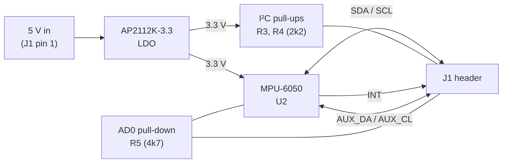

<div align="center">

# MPU-6050 Breakout Board

**A compact 6-axis IMU module with an onboard 3.3 V regulator, designed from scratch in KiCad 10.**


[Overview](#overview) · [Specs](#specifications) · [Pinout](#pinout) · [Schematic](#schematic) · [Layout](#pcb-layout) · [BOM](#bill-of-materials) · [Quick start](#quick-start) · [Manufacturing](#manufacturing) · [Errata](#known-issues-rev-10)

</div>

---

## Overview

This is a hand-designed breakout for the InvenSense **MPU-6050** (3-axis gyroscope + 3-axis accelerometer). The board takes **5 V in**, regulates it to **3.3 V** with an AP2112K LDO, and exposes the I²C bus, the interrupt line, the address-select pin and the auxiliary I²C master pins on a single 8-pin 2.54 mm header.

Everything in this repo is the original design: schematic, layout, Gerbers and BOM.

**Design goals**

- Small footprint with two M2.5 mounting holes
- Single 5 V supply, 3.3 V logic on the sensor side
- On-board I²C pull-ups, so it works straight out of the box on a 3.3 V MCU
- All MPU-6050 datasheet support components included (REGOUT, CPOUT, decoupling)
- Hand-solderable 0603 / 0805 passives

## Specifications

| Parameter | Value |
|---|---|
| Sensor | InvenSense MPU-6050 (QFN-24, 4×4 mm) |
| Regulator | AP2112K-3.3 (SOT-23-5, 600 mA LDO) |
| Supply input | 5 V on header pin 1 |
| Logic level | 3.3 V (pull-ups and VLOGIC tied to the 3.3 V rail) |
| Interface | I²C, default address `0x68` (`0x69` when AD0 is pulled high) |
| Board size | 25.8 mm × 22.3 mm |
| Layers / thickness | 2 layers / 1.6 mm |
| Min track / clearance | 0.2 mm / 0.2 mm |
| Mounting | 2 × 2.5 mm holes |
| Header | 1×8, 2.54 mm pitch |
| EDA | KiCad 10.0.7 |

## Gallery

<table>
  <tr>
    <td align="center"><br><sub>3D top</sub></td>
    <td align="center"><br><sub>3D bottom (header labels)</sub></td>
  </tr>
  <tr>
    <td align="center"><br><sub>Layout, red = top copper, blue = bottom copper</sub></td>
    <td align="center"><br><sub>Schematic (click to open the full image)</sub></td>
  </tr>
</table>

## Block diagram



## Pinout

<details open>
<summary><b>Header J1 (pin 1 is the square pad)</b></summary>

| Pin | Label | Direction | Description |
|:-:|:-:|:-:|---|
| 1 | `VCC` | In | 5 V supply input |
| 2 | `GND` | , | Ground |
| 3 | `SCL` | I/O | I²C clock (2k2 pull-up to 3.3 V on board) |
| 4 | `SDA` | I/O | I²C data (2k2 pull-up to 3.3 V on board) |
| 5 | `XDA` | I/O | Auxiliary I²C data (MPU-6050 `AUX_DA`) |
| 6 | `XCL` | I/O | Auxiliary I²C clock (MPU-6050 `AUX_CL`) |
| 7 | `AD0` | In | I²C address select. Pulled low by 4k7. Drive high for `0x69` |
| 8 | `INT` | Out | Interrupt output (data ready / motion) |

</details>

<details>
<summary><b>MPU-6050 pin connections used on this board</b></summary>

| U2 pin | Name | Connected to |
|:-:|---|---|
| 1 | CLKIN | GND (internal oscillator is used) |
| 6 | AUX_DA | J1 pin 5 (`XDA`) |
| 7 | AUX_CL | J1 pin 6 (`XCL`) |
| 8 | VLOGIC | 3.3 V |
| 9 | AD0 | J1 pin 7, R5 to GND |
| 10 | REGOUT | C4 (100 nF) to GND |
| 11 | FSYNC | GND |
| 12 | INT | J1 pin 8 |
| 13 | VDD | 3.3 V |
| 18 | GND | GND |
| 20 | CPOUT | C5 (2.2 nF) to GND |
| 23 | SCL | J1 pin 3, R4 pull-up |
| 24 | SDA | J1 pin 4, R3 pull-up |

Pins 2–5, 14–17 (NC) and 19, 21, 22 (RESV) are left unconnected, as the datasheet specifies.

</details>

## Schematic

<a href="docs/images/schematic.png"></a>

The schematic is split into three blocks:

| Block | Parts | Function |
|---|---|---|
| **MPU6050** | U2, C4, C5, C7, R3, R4, R5 | Sensor, datasheet support capacitors, I²C pull-ups, address pull-down |
| **LDO** | U1, C1, C2, C3, R1, R2 | 5 V to 3.3 V regulation, input and output capacitors, bleeder resistors |
| **Connector** | J1 | 8-pin breakout header |

## PCB layout

<a href="docs/images/pcb-layout.png"></a>

<details>
<summary><b>Layout notes</b></summary>

- Two-layer board with components on the top side only. Bottom copper carries the I²C routes and the ground return.
- Decoupling capacitors (C3, C4, C7) are placed next to the MPU-6050 supply pins.
- A keep-out (no copper) area is marked directly under the sensor package.
- The header sits on the bottom edge with a printed pin label for each signal. The labels are visible from the back of the board.
- Mounting holes are at the top corners, clear of all routing.

</details>

## Bill of materials

<details open>
<summary><b>15 line items (also available as <a href="hardware/bom.csv"><code>bom.csv</code></a>)</b></summary>

| Ref | Value | Package | Qty | Purpose |
|---|---|---|:-:|---|
| U2 | MPU-6050 | QFN-24, 4×4 mm | 1 | 6-axis IMU |
| U1 | AP2112K-3.3 | SOT-23-5 | 1 | 3.3 V LDO |
| C1 | 100 nF | 0603 | 1 | LDO input decoupling |
| C2 | 10 µF | 0805 | 1 | LDO output bulk |
| C3 | 100 nF | 0603 | 1 | 3.3 V rail decoupling |
| C4 | 100 nF | 0603 | 1 | MPU-6050 REGOUT |
| C5 | 2.2 nF | 0805 | 1 | MPU-6050 CPOUT |
| C7 | 10 µF | 0805 | 1 | MPU-6050 VDD bulk |
| R1 | 100 kΩ | 0603 | 1 | 5 V rail bleeder |
| R2 | 1 kΩ | 0603 | 1 | 3.3 V rail bleeder |
| R3, R4 | 2.2 kΩ | 0603 | 2 | I²C pull-ups |
| R5 | 4.7 kΩ | 0603 | 1 | AD0 pull-down |
| J1 | 1×8 header | 2.54 mm | 1 | Breakout header |
| H1, H2 | Mounting hole | 2.5 mm | 2 | Mechanical |

</details>

## Quick start

### 1. Wiring (3.3 V microcontroller, e.g. ESP32)

| Board pin | ESP32 pin |
|---|---|
| `VCC` | 5 V (VIN) |
| `GND` | GND |
| `SDA` | GPIO 21 |
| `SCL` | GPIO 22 |
| `INT` | optional, any GPIO |

> [!WARNING]
> The I²C lines on this board are pulled up to **3.3 V**. Use a 3.3 V MCU, or add a level shifter if your controller runs I²C at 5 V.

### 2. Test sketch

<details>
<summary><b>Arduino / ESP32 sketch (reads WHO_AM_I, acceleration, gyro and temperature)</b></summary>

```cpp
#include <Wire.h>

const uint8_t MPU_ADDR = 0x68;   // use 0x69 if AD0 is high

void writeReg(uint8_t reg, uint8_t val) {
  Wire.beginTransmission(MPU_ADDR);
  Wire.write(reg);
  Wire.write(val);
  Wire.endTransmission();
}

void setup() {
  Serial.begin(115200);
  Wire.begin();                  // ESP32 default: SDA 21, SCL 22
  writeReg(0x6B, 0x00);          // PWR_MGMT_1: wake up from sleep

  Wire.beginTransmission(MPU_ADDR);
  Wire.write(0x75);              // WHO_AM_I
  Wire.endTransmission(false);
  Wire.requestFrom(MPU_ADDR, (uint8_t)1);
  Serial.print("WHO_AM_I = 0x");
  Serial.println(Wire.read(), HEX);   // expect 0x68
}

void loop() {
  Wire.beginTransmission(MPU_ADDR);
  Wire.write(0x3B);              // ACCEL_XOUT_H
  Wire.endTransmission(false);
  Wire.requestFrom(MPU_ADDR, (uint8_t)14);

  int16_t ax = Wire.read() << 8 | Wire.read();
  int16_t ay = Wire.read() << 8 | Wire.read();
  int16_t az = Wire.read() << 8 | Wire.read();
  int16_t t  = Wire.read() << 8 | Wire.read();
  int16_t gx = Wire.read() << 8 | Wire.read();
  int16_t gy = Wire.read() << 8 | Wire.read();
  int16_t gz = Wire.read() << 8 | Wire.read();

  // Default ranges: +/-2 g (16384 LSB/g), +/-250 deg/s (131 LSB per deg/s)
  Serial.printf("A[g] %.2f %.2f %.2f | G[dps] %.1f %.1f %.1f | T %.1f C\n",
                ax / 16384.0, ay / 16384.0, az / 16384.0,
                gx / 131.0,  gy / 131.0,  gz / 131.0,
                t / 340.0 + 36.53);
  delay(200);
}
```

`Serial.printf` works on ESP32. On an AVR Arduino, replace it with `Serial.print` calls.

</details>

### 3. Bring-up checklist

- [ ] Visual inspection, no solder bridges on the QFN and the header
- [ ] Continuity check: 5 V to GND is not shorted
- [ ] Measure 3.3 V on the C2 / C7 pads with 5 V applied
- [ ] I²C scan finds a device at `0x68`
- [ ] `WHO_AM_I` returns `0x68`
- [ ] Accelerometer reads about 1 g on the axis pointing up
- [ ] Gyro reads close to 0 °/s at rest
- [ ] `AD0` driven high moves the device to `0x69`

## Manufacturing

<details>
<summary><b>Fabrication settings</b></summary>

| Setting | Value |
|---|---|
| Layers | 2 |
| Board thickness | 1.6 mm |
| Dimensions | 25.8 × 22.3 mm |
| Surface finish | HASL (the job file lists none, so pick any) |
| Min track / space | 0.2 mm / 0.2 mm |
| Solder mask / silkscreen | Any colour, both sides |
| Files to upload | [`hardware/MPU6050-gerbers.zip`](hardware/MPU6050-gerbers.zip) |

</details>

<details>
<summary><b>Assembly notes</b></summary>

1. Solder U2 (QFN-24) first, using hot air or reflow with paste. Its thermal pad is not used for heat sinking, so do not add extra solder under it.
2. Place U1 and the passives next.
3. Solder the header last, with the long pins on the bottom side for breadboard use.
4. Clean flux residue around the QFN before testing.

</details>

## Repository structure

```
mpu6050-breakout-pcb/
├── README.md
├── LICENSE
├── docs/
│   └── images/            # renders, layout and schematic images
└── hardware/
    ├── bom.csv
    ├── MPU6050-gerbers.zip   # ready to upload to a PCB fab
    ├── gerber/               # individual Gerber and drill files
    └── kicad/                # KiCad 10 project (.kicad_pro, .kicad_sch, .kicad_pcb)
```

## Open the design

```bash
git clone https://github.com/<your-username>/mpu6050-breakout-pcb.git
cd mpu6050-breakout-pcb/hardware/kicad
kicad MPU6050.kicad_pro
```

Requires KiCad 10 or newer.

## Known issues (Rev 1.0)

<details open>
<summary><b>EN pin of the AP2112K is not connected</b></summary>

On Rev 1.0, pin 3 (`EN`) of U1 is left unconnected in the schematic and on the PCB. The enable pin of an LDO should be driven to a defined level; for always-on operation it is tied to VIN.

- **Rev 1.1 fix:** connect U1 pin 3 (EN) to U1 pin 1 (VIN, the 5 V net) in the schematic and re-route.
- **Workaround on a built Rev 1.0 board:** solder a short wire from U1 pin 3 to pin 1.

</details>

## Roadmap

- [x] Schematic capture
- [x] PCB layout and DRC
- [x] Gerber and BOM export
- [ ] Fabricate and assemble
- [ ] Bring-up and test results
- [ ] Rev 1.1 with the EN fix
- [ ] Add a status LED and solder jumper for the I²C address

## Author

**Kaushik**, B.E. Electronics and Communication Engineering, Chennai Institute of Technology (batch of 2029)

[GitHub](https://github.com/<your-username>) · [LinkedIn](https://www.linkedin.com/in/<your-handle>)

## License

Released under the [MIT License](LICENSE).

## Acknowledgements

- InvenSense MPU-6000/MPU-6050 datasheet and register map
- Diodes Inc. AP2112 datasheet
- KiCad official symbol and footprint libraries
