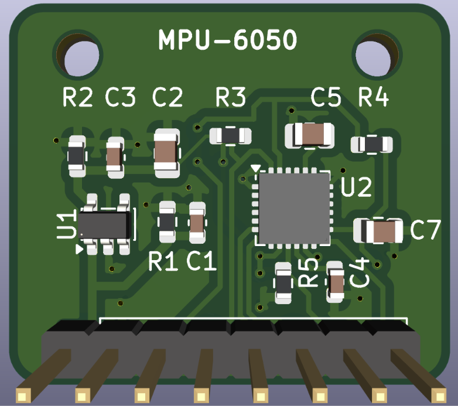
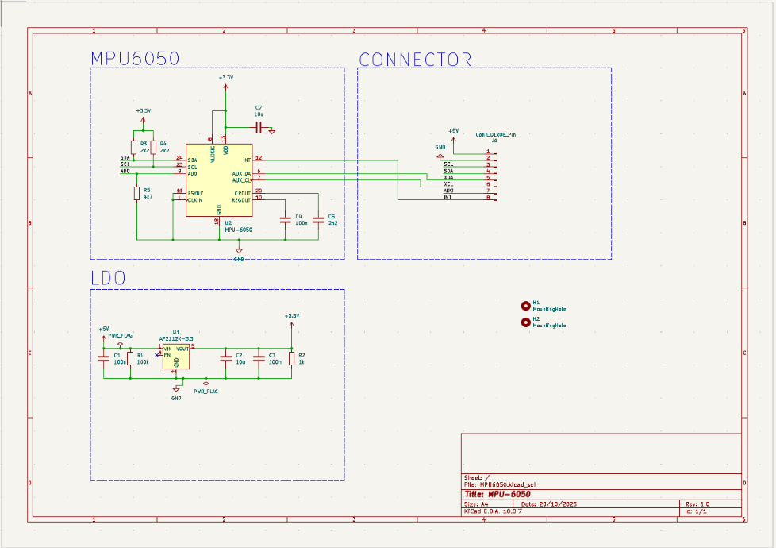
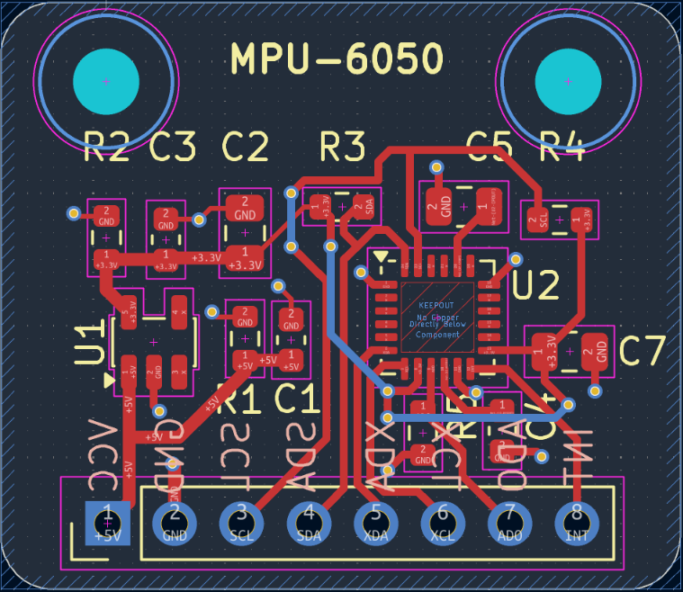
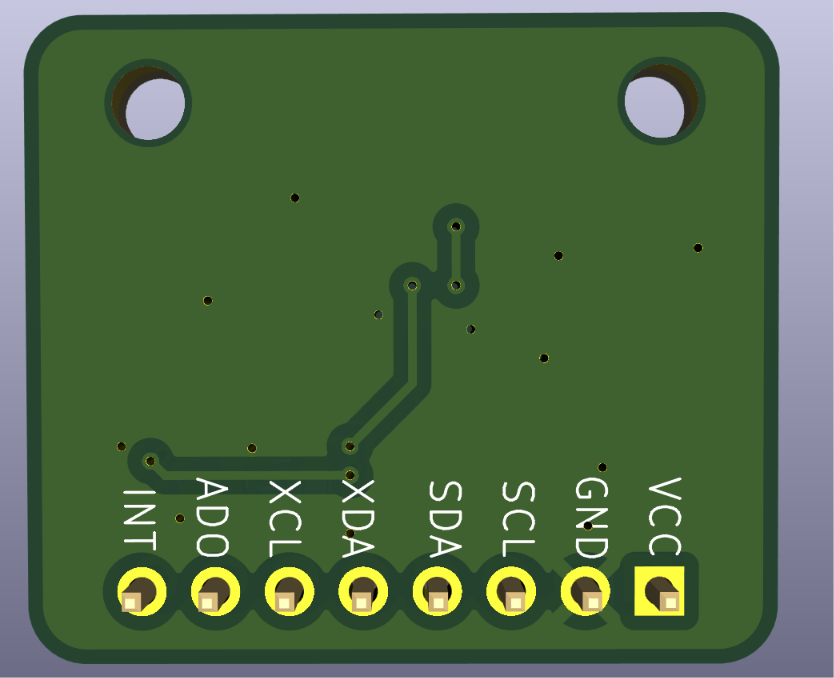

# MPU-6050 Breakout Board

A small breakout board for the MPU-6050 (3-axis gyroscope + 3-axis accelerometer), designed in KiCad. It runs from a 5 V supply, regulates it to 3.3 V on board, and brings out the I²C pins on an 8-pin header.



## Features

- MPU-6050 6-axis motion sensor, I²C interface
- On-board 3.3 V regulator (AP2112K-3.3), powered from 5 V
- On-board I²C pull-up resistors (2.2 kΩ)
- Selectable I²C address: `0x68` (default) or `0x69`
- 2-layer board, 25.8 mm × 22.3 mm, two 2.5 mm mounting holes

## Pinout

| Pin | Name | Description |
|:-:|:-:|---|
| 1 | VCC | 5 V input |
| 2 | GND | Ground |
| 3 | SCL | I²C clock |
| 4 | SDA | I²C data |
| 5 | XDA | Auxiliary I²C data |
| 6 | XCL | Auxiliary I²C clock |
| 7 | AD0 | Address select (low = `0x68`, high = `0x69`) |
| 8 | INT | Interrupt output |

> The I²C lines are pulled up to 3.3 V. Use a 3.3 V microcontroller (for example ESP32) or add a level shifter for 5 V logic.

## Schematic



## PCB

| Layout | Back view |
|:-:|:-:|
|  |  |

## Bill of Materials

| Reference | Value | Package | Qty |
|---|---|---|:-:|
| U1 | AP2112K-3.3 | SOT-23-5 | 1 |
| U2 | MPU-6050 | QFN-24 (4×4 mm) | 1 |
| C1, C3, C4 | 100 nF | 0603 | 3 |
| C2, C7 | 10 µF | 0805 | 2 |
| C5 | 2.2 nF | 0805 | 1 |
| R1 | 100 kΩ | 0603 | 1 |
| R2 | 1 kΩ | 0603 | 1 |
| R3, R4 | 2.2 kΩ | 0603 | 2 |
| R5 | 4.7 kΩ | 0603 | 1 |
| J1 | 1×8 pin header, 2.54 mm | Through-hole | 1 |

The same list is in [`hardware/bom.csv`](hardware/bom.csv).

## Usage

Connect the board to an ESP32:

| Board | ESP32 |
|---|---|
| VCC | 5 V |
| GND | GND |
| SDA | GPIO 21 |
| SCL | GPIO 22 |

Test sketch (reads the WHO_AM_I register, which should return `0x68`):

```cpp
#include <Wire.h>

void setup() {
  Serial.begin(115200);
  Wire.begin();

  Wire.beginTransmission(0x68);
  Wire.write(0x6B);            // wake the sensor
  Wire.write(0x00);
  Wire.endTransmission();

  Wire.beginTransmission(0x68);
  Wire.write(0x75);            // WHO_AM_I register
  Wire.endTransmission(false);
  Wire.requestFrom(0x68, 1);
  Serial.println(Wire.read(), HEX);
}

void loop() {}
```

## Files

```
├── docs/images/      Images used in this README
├── hardware/
│   ├── kicad/        KiCad project (schematic and PCB)
│   ├── gerber/       Gerber and drill files
│   ├── MPU6050-gerbers.zip   Ready to upload to a PCB manufacturer
│   └── bom.csv       Bill of materials
└── README.md
```

Open `hardware/kicad/MPU6050.kicad_pro` in KiCad 10 or newer.

## Known issue (Rev 1.0)

The EN pin (pin 3) of the AP2112K regulator is not connected. It should be tied to VIN (pin 1). On a built board, solder a short wire between these two pins. This will be fixed in the next revision.

## Author

Kaushik, B.E. Electronics and Communication Engineering, Chennai Institute of Technology

## License

MIT License
