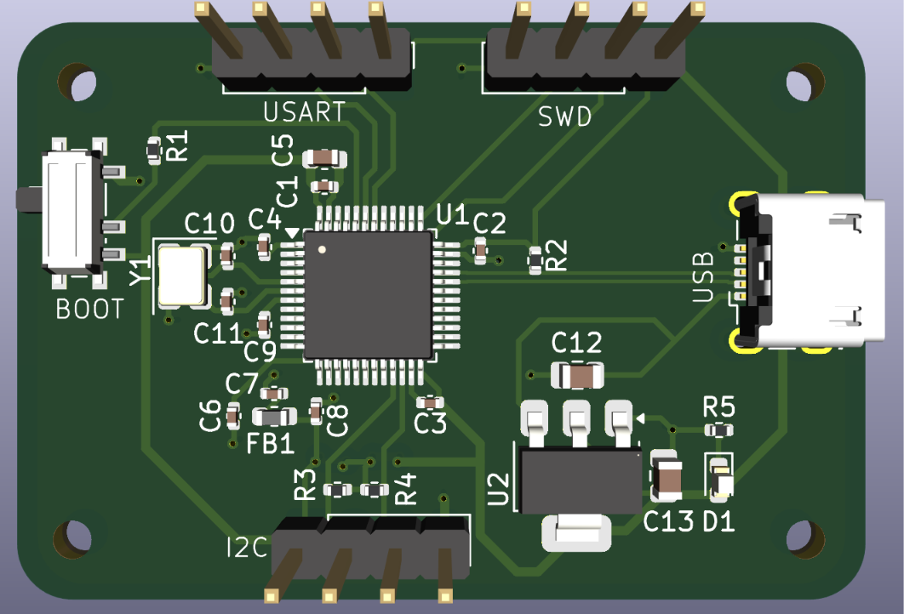
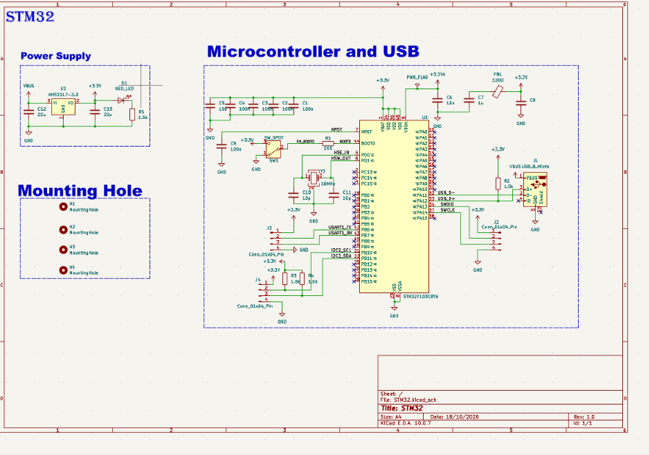
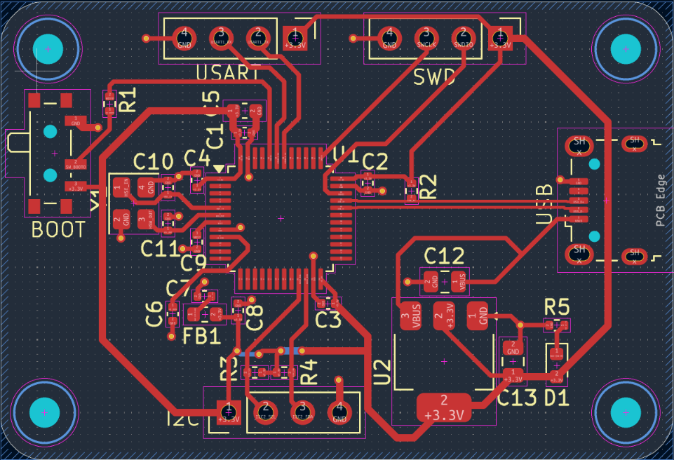

# STM32F103C8T6 Development Board

A simple STM32 development board built around the **STM32F103C8T6** (Arm Cortex-M3, LQFP-48), designed in KiCad. It is powered over USB, has an on-board 3.3 V regulator, and brings out SWD, USART and I²C on separate headers.

## Features

- STM32F103C8T6 microcontroller (Cortex-M3, 72 MHz)
- Micro-USB connector for power and USB data (PA11 / PA12)
- 3.3 V regulator (AMS1117-3.3) with a red power LED
- 16 MHz crystal (HSE)
- SWD header for programming and debugging
- USART header and I²C header
- BOOT switch to select the BOOT0 level
- Filtered analog supply (ferrite bead on VDDA)
- Four mounting holes

## Main Components

| Part | Function |
|---|---|
| STM32F103C8T6 (U1) | Microcontroller |
| AMS1117-3.3 (U2) | 5 V to 3.3 V regulator |
| 16 MHz crystal (Y1) | External clock |
| Micro-USB (J1) | Power and USB data |
| Ferrite bead (FB1) | VDDA supply filter |
| Red LED (D1) | Power indicator |
| SPDT switch (SW1) | BOOT0 selection |

## Headers

All headers are 1×4, 2.54 mm pitch.

| Pin | USART (J3) | SWD (J2) | I²C (J4) |
|:-:|---|---|---|
| 1 | 3.3 V | 3.3 V | 3.3 V |
| 2 | USART1_TX | SWDIO | I2C2_SCL |
| 3 | USART1_RX | SWCLK | I2C2_SDA |
| 4 | GND | GND | GND |

## Pin Usage

| Function | MCU pin |
|---|---|
| USB D− / D+ | PA11 / PA12 |
| SWDIO / SWCLK | PA13 / PA14 |
| USART1 TX / RX | PB6 / PB7 |
| I2C2 SCL / SDA | PB10 / PB11 |
| HSE crystal | PD0 / PD1 |

The I²C lines have pull-up resistors to 3.3 V on the board.

## Schematic

## PCB Layout

## Getting Started

1. Connect the board to a PC with a micro-USB cable. The red LED turns on when the 3.3 V rail is up.
2. Connect an ST-Link to the SWD header: 3.3 V, SWDIO, SWCLK and GND.
3. Open your project in STM32CubeIDE (or any STM32 toolchain), select the `STM32F103C8Tx` device and flash it.

## Files

| File | Description |
|---|---|
| `STM32_sch.png` | Schematic image |
| `STM32_Layout.png` | PCB layout image |
| `STM32_3D.png` | 3D render |

KiCad project files and Gerbers are in the project zip. Open the `.kicad_pro` file in KiCad 10 or newer.

## Author

Kaushik, B.E. Electronics and Communication Engineering, Chennai Institute of Technology

## License

MIT License
